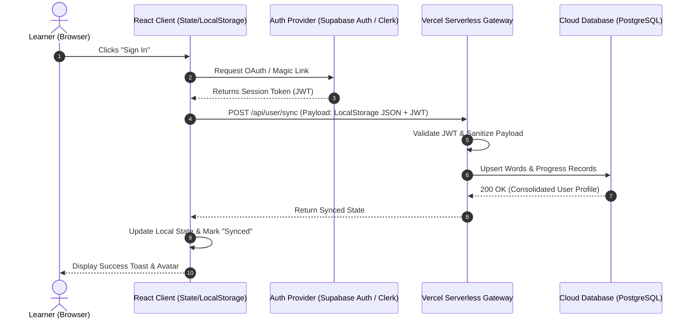

# Product Requirements Document (PRD)
## Nipp-On v1.1: Cloud Authentication & Cross-Device Notebook Sync

* **Document Owner:** Akhil Kumar (Associate Product Manager)  
* **Target Delivery:** v1.1 Release  
* **Cross-Functional Team:** 1 Product Designer, 2 Full-Stack Engineers  
* **Status:** Ready for Engineering Review  
* **Parent Strategy:** [PRODUCT_CASE_STUDY.md](./PRODUCT_CASE_STUDY.md)  

---

## 1. Problem Statement & Background

### 1.1 Customer Friction & Support Signals
In the current production release (v1.0), all learner data—including daily streaks, custom vocabulary cards, audio attempt history, and the Saved Notebook—is persisted exclusively in browser `localStorage`.

This creates severe customer drop-off and support friction:
1. **Device Locking:** A learner practicing on their laptop during work hours cannot access their saved notebook or continue their daily streak on their tablet/mobile in the evening.
2. **Permanent Data Loss:** Users clearing browser cookies or running privacy extensions inadvertently wipe their entire study progress and streak history.
3. **Low Retention Anchor:** Without an account identity, there is no mechanism to re-engage lapsed learners via email/push digest or provide long-term JLPT N5 milestone tracking.

### 1.2 Objective & Goals
* **Primary Objective:** Provide seamless account authentication and automatic cloud synchronization so learners can access their notebook and retain study streaks across any device without losing guest progress.
* **Key Success Metric:** $\ge 40\%$ of 3-day active guest users convert to registered accounts; cloud data sync error rate $< 0.1\%$.

### 1.3 Out of Scope (Non-Goals)
* Paid subscription / billing infrastructure (deferred to v2.0).
* Social sharing / friend leaderboards (deferred to v2.0).
* Multi-language interface localization (English-only for v1.1).

---

## 2. User Personas & Core Workflows

### 2.1 Personas Involved
* **The New Guest Learner:** Lands on the web app, searches 3 words, and bookmarks 2 items without wanting to fill out an upfront signup form.
* **The Converting Daily Learner:** Has used the app for 3 days as a guest and wants to preserve their streak and notebook before clearing browser cache or switching to mobile.
* **The Multi-Device Learner:** Regularly alternates between a desktop browser at their desk and a tablet on the sofa.

---

## 3. User Stories & Acceptance Criteria

### User Story 1: Frictionless Social & Magic Link Signup
> **As a** guest learner who has bookmarked vocabulary,  
> **I want to** sign up in one click using Google or a Magic Link,  
> **So that** I don't have to remember another password or interrupt my study session.

#### Acceptance Criteria
* **AC 1.1:** Clicking "Sign In / Sync" in the Top Navigation opens a lightweight modal offering *Continue with Google* and *Email Magic Link*.
* **AC 1.2:** Authentication must complete without full page reloads, preserving the user’s current screen state and active vocabulary card.
* **AC 1.3:** Upon successful authentication, the Top Navigation replaces the "Sign In" button with the user's avatar/initials and an active "Cloud Synced" status dot.

---

### User Story 2: Seamless Guest-to-Cloud Data Migration
> **As a** guest learner creating an account for the first time,  
> **I want** my existing local streaks and saved notebook words to automatically migrate to my new account,  
> **So that** I don't lose the vocabulary I curated before signing up.

#### Acceptance Criteria
* **AC 2.1 (Given-When-Then):**
  * **Given:** A guest user has 6 saved words and a 3-day streak stored in `localStorage`.
  * **When:** The user authenticates for the first time.
  * **Then:** The client initiates a bulk migration payload to `POST /api/user/sync`.
  * **And:** The backend merges the guest words into the user's PostgreSQL database table without duplicate records.
  * **And:** The UI displays a brief toast: *"Your 6 saved words and 3-day streak are now backed up to your account!"*

---

### User Story 3: Multi-Device Conflict Resolution
> **As a** learner switching between my laptop and mobile browser,  
> **I want** changes made on one device to sync to the other,  
> **So that** my notebook and quiz progress remain consistent.

#### Acceptance Criteria
* **AC 3.1:** When a user logs in on a new device, the local state is populated with the latest server state (Last-Write-Wins based on ISO timestamps).
* **AC 3.2:** If a word is saved locally while offline, it is queued and synchronized automatically upon reconnection (`window.ononline`).
* **AC 3.3:** Streak count resolution takes the **maximum contiguous valid streak** recorded across devices for the same calendar date.

---

## 4. Detailed Functional Specifications

### 4.1 System Architecture Flow

### 4.2 Data Schema Specifications

#### Table: `users`
| Column | Type | Constraints | Description |
| :--- | :--- | :--- | :--- |
| `id` | `UUID` | Primary Key | Generated by Auth Provider |
| `email` | `VARCHAR(255)` | Unique, Not Null | User contact email |
| `streak_days` | `INT` | Default 0 | Current contiguous day streak |
| `last_active_date` | `DATE` | Default CURRENT_DATE | Last completed study session date |
| `daily_goal` | `INT` | Default 5 | User's daily target word count |
| `created_at` | `TIMESTAMPTZ` | Default NOW() | Account creation timestamp |

#### Table: `saved_words`
| Column | Type | Constraints | Description |
| :--- | :--- | :--- | :--- |
| `id` | `VARCHAR(100)` | Composite PK (`user_id`, `id`) | Normalized word ID (e.g., `taberu`) |
| `user_id` | `UUID` | Foreign Key -> `users.id` | Cascading delete on account deletion |
| `japanese` | `VARCHAR(100)` | Not Null | Kanji / Surface form |
| `hiragana` | `VARCHAR(100)` | Not Null | Phonetic reading |
| `romaji` | `VARCHAR(100)` | Not Null | Latinized transcription |
| `english` | `TEXT` | Not Null | Primary English translation |
| `pitch_accent` | `JSONB` | Nullable | Notation and mora pitch array |
| `saved_at` | `TIMESTAMPTZ` | Default NOW() | Timestamp of bookmark |

---

## 5. UI/UX Design Specifications (Handoff to Product Designer)

1. **Top Navigation Bar:**
   * **Guest State:** Add a subtle pill button: `[ ☁️ Save Progress ]` (Pine Forest secondary outline).
   * **Authenticated State:** Display user profile icon with a micro green badge indicating "Synced". Clicking opens a drawer with account email, streak history, and a "Sign Out" button.
2. **Auth Modal:**
   * Clean, distraction-free modal styled with Google Stitch tokens (Pine Forest Green `#013628` and Terracotta `#97472E`).
   * Value prop callout: *"Back up your notebook, sync across devices, and never lose your streak."*
3. **Offline Indicator:**
   * If the browser loses network connectivity, the sync dot changes from green to amber: *"Offline — Changes saved locally and will sync when reconnected."*

---

## 6. Technical & Operational Constraints (Handoff to Engineering)

1. **Zero Cold-Start Degradation:** Keep the sync serverless handler (`/api/user/sync`) lightweight without bloated ORM dependencies.
2. **Security & Session Management:**
   * JWT stored in secure `HttpOnly` cookie or memory; no raw secret keys exposed in client bundles.
   * Rate limiting: Max 30 sync calls per minute per authenticated user to prevent database thrashing.
3. **Backward Compatibility:**
   * The client must never overwrite existing `localStorage` data until the server returns an explicit `200 OK` confirming successful migration.
   * If the API fails with a `500` or network timeout, local data remains intact and the app continues in guest mode with an unobtrusive retry notice.

---

## 7. Edge Cases & Failure Modes

| Edge Case | Failure Mode | Required System Behavior |
| :--- | :--- | :--- |
| **Partial Network Drop During Migration** | User signs in, but connection drops midway through sending local words to cloud. | Client retains local data and displays a retry toast. Server transaction rolled back (atomic SQL transaction). |
| **Conflicting Word Updates Across 2 Tabs** | Word is removed in Tab A and edited in Tab B. | Timestamp comparison: Most recent `saved_at` action wins. |
| **Guest Exceeds Storage Limits** | Guest user bookmarks 200+ words exceeding local storage limits before signing in. | UI prompts an immediate account creation banner: *"Your notebook is growing! Sign in to keep adding words."* |
| **Account Deletion Request** | User requests account removal under privacy compliance (GDPR/DPDP). | Hard delete cascade across `users` and `saved_words`. Client `localStorage` wiped upon sign-out. |

---

## 8. Success Metrics & Post-Launch Monitoring

* **Adoption:**
  * Guest-to-Registered Conversion Rate (Target: $>35\%$ within 7 days of first visit).
  * Weekly Multi-Device Sessions (% of users active on $>1$ client).
* **System Reliability:**
  * Sync Success Rate: $>99.9\%$.
  * Sync Latency: $p95 < 400\text{ms}$.
* **Product Retention Impact:**
  * 14-day retention difference between registered users vs. guest users (Target: $+25\%$ lift for registered cohort).
