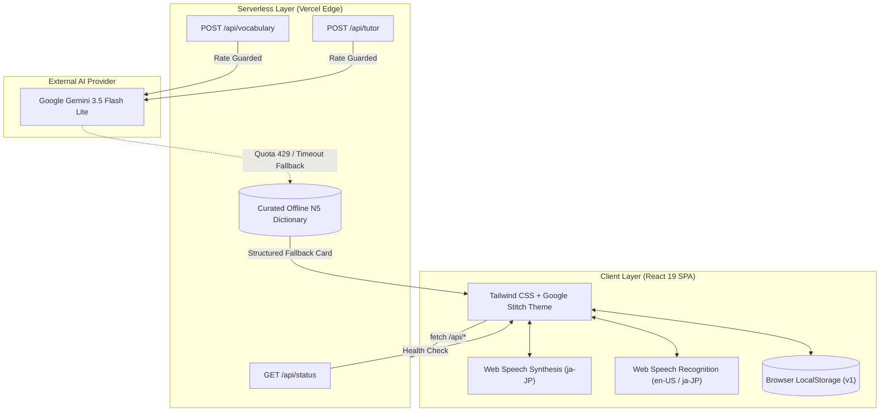

# Product Requirements Document (PRD)
## Nipp-On v1.0: Core MVP — Voice & AI Japanese Vocabulary Coach

* **Document Owner:** Akhil Kumar (Associate Product Manager / Product Operations)  
* **Product:** Nipp-On (日本-Go)  
* **Release Version:** v1.0 (Current Live Production Release)  
* **Live Deployment:** [https://nipp-on.vercel.app/](https://nipp-on.vercel.app/)  
* **API Health Endpoint:** [https://nipp-on.vercel.app/api/status](https://nipp-on.vercel.app/api/status)  
* **Repository:** [https://github.com/akhilkumar0024/Nipp-On](https://github.com/akhilkumar0024/Nipp-On)  
* **Strategic Context:** [PRODUCT_CASE_STUDY.md](./PRODUCT_CASE_STUDY.md)  
* **Next Version PRD (Roadmap):** [PRD_CLOUD_SYNC.md](./PRD_CLOUD_SYNC.md)  

---

## 1. Executive Summary & Problem Scope

### 1.1 Problem Statement
Beginner JLPT N5 self-learners face three distinct points of friction in mainstream language learning apps:
1. **The "Mizu" Problem (Repetitive Drills without Depth):** Mainstream apps force adult learners through repetitive single-word drills without explaining grammar particles, register (polite vs. plain), or situational nuance.
2. **Pitch Accent & Cadence Neglect:** Standard tools focus on passive visual recognition, ignoring Japanese mora timing and pitch accent contours (*Atamadaka*, *Heiban*, *Nakadaka*).
3. **Fragility of AI Prototypes:** Many AI-based learning prototypes crash or throw raw 500 errors when cloud API quotas are exhausted.

### 1.2 Product Objective
Build an intuitive, resilient web application that provides:
* Instant structured lexical analysis (Kanji, Furigana, Romaji, and visual pitch accent mora graphs).
* Active vocalization practice with speech synthesis and speech recognition evaluation.
* An on-demand AI Sensei tutor for contextual questions.
* Retention reinforcement through a 5-question multi-choice quiz engine and personal notebook.
* High operational resilience via a dual-tier Gemini backend with an offline curated fallback circuit breaker.

---

## 2. Target User & Persona

* **Persona:** The "Serious Self-Starter" (JLPT N5 Aspirant).
* **Demographic:** Working professionals or university students studying Japanese independently, often motivated by anime, gaming, or upcoming JLPT N5 exams.
* **Environment:** Desktop and laptop web browsers (10–15 minute daily micro-sessions).
* **Key User Need:** Immediate clarity on pronunciation, grammar register, and real-world usage without reading 400-page textbooks.

---

## 3. Product Architecture & Deployed Tech Stack

---

## 4. Feature Specifications (Live Functionality)

### 4.1 Screen 1: Dashboard & Habit Tracking
* **Daily Readiness Hero Card:**
  * Displays contiguous day streak counter (`streakDays`) calculated from calendar activity dates.
  * Displays "Ichigo Ichie" (*一期一会*) cultural proverb callout for daily motivation.
  * Direct CTA: `Start Daily Session` (configured to user's daily word goal).
* **Readiness & Goals Module:**
  * Visual progress bar showing words studied today vs. daily goal (default: 5 words).
  * Real-time pronunciation accuracy score averaged across recorded speech attempts.
  * Total pronunciation attempts counter.
* **Daily Milestone Card:**
  * Shows active word card preview with immediate audio playback button and quick navigation to study details.
* **Quick Drill Launcher:**
  * One-click trigger to launch a 5-question speed quiz.
* **Notebook Snapshot:**
  * Mini-list displaying up to 3 recently saved words with audio pronunciation buttons and a link to the full notebook.

---

### 4.2 Screen 2: Vocabulary Explorer & Speech Coach
* **Search & Input:**
  * Text search supporting English (*eat*, *water*), Romaji (*taberu*, *mizu*), and Japanese (*食べる*, *水*).
  * One-click quick search pills for common starter words: `eat`, `drink`, `book`, `water`, `cat`, `friend`, `delicious`.
  * Voice Search: English speech-to-text (`en-US`) using `webkitSpeechRecognition`.
* **Structured Lexical Card:**
  * Header Tags: JLPT Level (`N5`), Part of Speech (e.g. *Transitive Verb*), Frequency (*Essential Core*), and Data Source badge (`Live Gemini AI` vs. `Curated N5 Database`).
  * Bookmark Icon: One-click save/remove from the user's Notebook with animated toast notification.
  * Japanese Typography: Noto Serif JP kanji hero display with ruby Furigana (Hiragana) and Romaji transcription.
  * Pitch Accent Mora Diagram: Visual step chart indicating High/Low pitch steps for each mora (e.g. `[ta-BE-ru]` Atamadaka pattern).
  * Nuance & Register Breakdown: Pedagogical explanation of polite vs. plain forms and common particle pairings (e.g. `ご飯を食べる`).
  * Contextual Example Sentence: Complete Japanese sentence with Furigana, Romaji, and English translation.
* **Audio & Pronunciation Assessment:**
  * Audio Playback: Native TTS speaking phonetic Hiragana (`word.hiragana`) to guarantee Kun'yomi pronunciation integrity. Speed selector: `0.75x`, `1.0x`, `1.25x`.
  * Japanese Speech Practice (`ja-JP`): User speaks target word into microphone. System calculates phonetic transcript match (Score: 95% for target match; 82% fallback attempt) and records score to user profile.
  * Practice Mode Toggle: Allows switching between microphone voice practice and typing input.
* **Tutor Deep-Dive CTA:**
  * Prominent button: *"Ask Sensei about this word"*, transitioning user directly to the AI Tutor with context preloaded.

---

### 4.3 Screen 3: AI Sensei Conversational Tutor
* **Split-Pane Architecture:**
  * Left Sidebar: Anchored context card displaying the current vocabulary term and quick-select pills from saved notebook words.
  * Right Chat Canvas: Active dialogue thread between learner and AI Sensei.
* **Conversational Intelligence (`/api/tutor`):**
  * Powered by Gemini 3.5 Flash Lite with rate-limiting guards and memory capped to the last 8 messages.
  * Dynamic Follow-Up Chips: 3 contextual suggestion chips per turn (e.g., *"How do I order this in a formal restaurant?"*, *"Explain casual vs. polite forms"*).
  * Markdown Parser: Renders bolding, italics, inline code, and bulleted lists cleanly without exposing raw markdown asterisks.
  * In-Chat Audio: Speaker icon alongside Japanese phrases in Sensei's replies for immediate pronunciation playback.
  * Markdown Audio Sanitization: Regex filters strip all formatting symbols (`*`, `_`, `#`, `` ` ``) before sending text to speech synthesis.

---

### 4.4 Screen 4: Practice & Saved Notebook
* **Active Session Timer:** Live `MM:SS` stopwatch tracking study engagement duration.
* **Sub-Tab 1: 5-Question Interactive Quiz:**
  * Dynamically assembled from saved notebook words (if $\ge 3$ words saved) or curated JLPT N5 pool.
  * Question Types: Verb Conjugation, Kanji Reading, English Meaning, and Audio Comprehension.
  * Instant Answer Feedback: Highlights correct/incorrect selections, provides detailed grammatical explanations, and awards +15 XP.
  * Completion Summary: Score breakdown (e.g. 4/5, 80%), XP earned, streak counter, celebratory confetti animation, and direct link to view saved notebook.
* **Sub-Tab 2: Saved Vocabulary Notebook:**
  * Full list of bookmarked terms saved in `localStorage`.
  * Filter search bar to search through saved vocabulary.
  * Action controls per card: Instant audio pronunciation, launch study drill, or remove from notebook.
  * Zero-State Onboarding: Displays empty state guidance with a one-click *"Load 4 Starter JLPT N5 Words"* button.

---

### 4.5 Modals & Settings
* **Audio Settings Modal:** Dropdown to select system Japanese voice engine, speech rate slider (`0.5x` to `1.5x`), base pitch slider, and audio test button.
* **Learner Profile Modal:** Daily word goal adjuster (3 to 20 words), total words studied, streak days, live Gemini API health indicator, and a prototype reset button.
* **User Feedback Modal:** 5-star rating selector and feedback comments box.

---

## 5. Technical Resilience & Failure Handling

| Failure Vector | Risk | System Mitigation |
| :--- | :--- | :--- |
| **Kanji TTS Mispronunciation** | Browser TTS defaults to On'yomi (e.g. pronouncing `水` as *sui* instead of *mizu*). | Audio service strictly dispatches phonetic Hiragana (`word.hiragana`) to `SpeechSynthesisUtterance`. |
| **TTS Formatting Pronunciation** | AI responses contain markdown (`**水**`), causing speech engines to read *"asterisk asterisk"*. | Regular expression sanitizer strips all markdown characters prior to speech dispatch. |
| **Gemini Rate Limit (429) or Quota Depletion** | API quota exceeded, causing server 500 crashes and breaking user study flow. | Serverless endpoint catches errors, falls back to pre-curated JLPT N5 dictionary (`curatedVocab.ts`), and returns structured card tagged `curated-fallback`. Zero UI crashes. |
| **Unsupported Browser for Speech Recognition** | Web Speech API unavailable in non-Chromium browsers (Firefox, Safari). | Graceful degradation: Shows informative toast guiding learner to use text search or typing practice. |
| **Corrupted Client Storage** | User edits or corrupts `localStorage` JSON strings. | Storage service implements schema versioning (`v1`) with JSON parse try/catch, auto-sanitizing null or malformed fields to default values. |

---

## 6. Success & Operational Metrics

* **Core Habit Metric:** Daily Active Sessions completing the target daily word goal ($\ge 5$ words).
* **Pronunciation Engagement Rate:** $\%$ of sessions with $\ge 1$ microphone pronunciation attempt.
* **API Availability:** $100\%$ zero-crash user sessions maintained via the curated offline circuit breaker.
* **Quiz Completion Rate:** $\%$ of started 5-question quizzes completed through the celebratory confetti screen.
