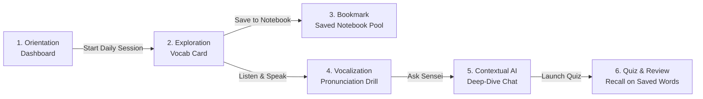
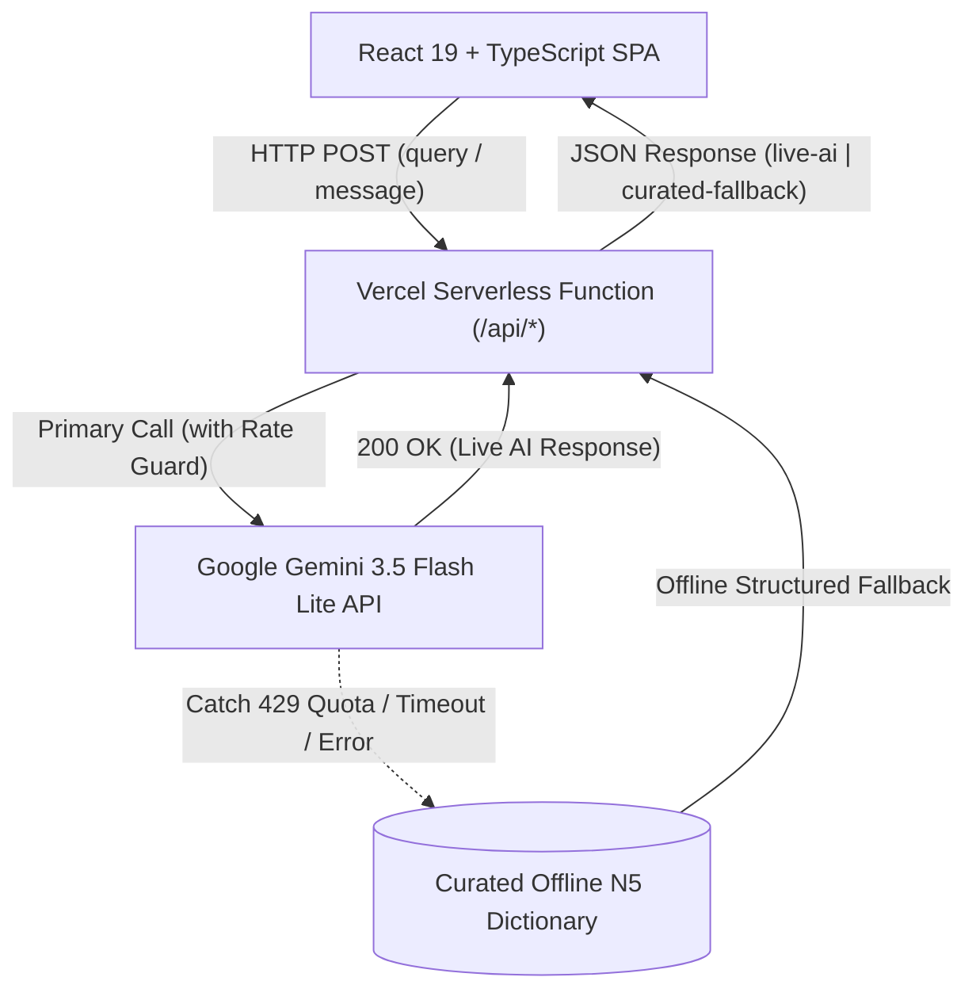

# Product Case Study: Nipp-On (日本-Go)
## Building an AI-Powered Voice & Vocabulary Coach for JLPT N5 Learners

* **Author:** Akhil Kumar  
* **Product:** Nipp-On (日本-Go)  
* **Type:** Zero-to-One Product Case Study & MVP Specification  
* **Live Application:** [https://nipp-on.vercel.app/](https://nipp-on.vercel.app/)  
* **GitHub Repository:** [https://github.com/akhilkumar0024/Nipp-On](https://github.com/akhilkumar0024/Nipp-On)  
* **Architecture Reference:** [PROJECT_CONTEXT.md](./PROJECT_CONTEXT.md)  

---

## 1. Executive Summary

Nipp-On is a voice-first Japanese vocabulary learning application designed for beginner (JLPT N5) self-learners. It addresses a major gap in mainstream language learning apps: the trade-off between superficial gamification and actionable linguistic depth.

While popular platforms like Duolingo excel at top-of-funnel acquisition, adult learners frequently drop off due to repetitive, low-complexity drills that neglect pronunciation cadence, pitch accent contours, and conversational context. 

To solve this, Nipp-On combines:
1. **Structured Lexical Cards:** Instant access to Kanji, Furigana, Romaji, and visual mora pitch-accent graphs.
2. **Contextual AI Tutoring:** An on-demand Sensei capable of explaining grammar registers (polite vs. plain) and situational usage.
3. **Low-Latency Voice Interaction:** Native speech synthesis and browser speech recognition designed specifically for active recall and vocalization.
4. **Resilient Architecture:** A dual-tier backend and offline fallback circuit breaker ensuring uninterrupted learning during third-party API rate limits or outages.

This document outlines the product rationale, target user definition, MVP scope, core user flows, technical constraints, and future product roadmap.

---

## 2. Problem Statement & User Discovery

### 2.1 The Market & User Friction (The "Mizu" Problem)
Beginner Japanese learners (particularly those motivated by anime, gaming, or cultural interest) typically begin their journey on gamified mobile apps. However, post-onboarding retention drops sharply due to three structural friction points:

1. **Repetition Fatigue & Low Ceiling:**  
   Apps frequently force adult users through repetitive matching drills of isolated single words (e.g., repeating *"mizu"* five times) without explaining grammar particles, politeness levels, or cultural context.
2. **Pitch Accent & Cadence Blindness:**  
   Japanese is a pitch-accent language where mora timing matters. Standard flashcard tools focus on passive visual recognition, leaving learners hesitant to speak because they cannot hear or visualize pitch contours.
3. **Tool Fragmentation:**  
   Learners currently juggle three or four disparate tools:
   * A digital dictionary (e.g., Jisho) for definitions.
   * A spaced repetition flashcard tool (e.g., Anki) with complex manual configuration.
   * A static textbook (e.g., Genki) for grammar rules.
   * Generic LLMs (ChatGPT) for conversational context.

### 2.2 Target User Persona

| Attribute | Details |
| :--- | :--- |
| **Persona** | The "Serious Self-Starter" (JLPT N5 Aspirant) |
| **Profile** | Working professionals or university students studying Japanese independently. |
| **Motivation** | Inspired by Japanese media (anime, manga) or preparing for the JLPT N5 examination. |
| **Study Pattern** | Micro-sessions of 10–15 minutes daily on desktop or laptop. |
| **Key Needs** | Quick lookups, immediate phonetic feedback, and conversational clarity without reading dry 400-page textbooks. |
| **Anti-Persona** | Casual gamers who only want 2-minute badge-collecting loops and do not care about speaking accuracy or grammar mechanics. |

### 2.3 Value Proposition
> **For** independent JLPT N5 learners frustrated by repetitive gamified drills,  
> **Nipp-On is** a voice-first Japanese vocabulary coach  
> **that** integrates structured lexical cards, pitch accent visualization, and an on-demand AI tutor,  
> **unlike** Duolingo or static flashcards, which test passive memorization without explaining linguistic nuance.

---

## 3. Product User Journey: The Daily Study Loop

The primary user loop is designed around a 10-minute micro-study habit:

### End-to-End Walkthrough

| Step | User Action | System Feedback | Core Value Delivered |
| :--- | :--- | :--- | :--- |
| **1. Orient** | Lands on Dashboard; checks daily progress and streak. | Displays active streak, target goal (e.g. 0/5 words), and daily proverb (*Ichigo Ichie*). | Low-anxiety, uncluttered starting point. |
| **2. Explore** | Searches a word (e.g., *"eat"* / 食べる) via text or voice. | Loads structured card: Kanji, Furigana, Romaji, English meaning, frequency, and pitch diagram (`[ta-BE-ru]`). | **Linguistic "Aha!":** Instantly see *why* the accent drops at *BE*. |
| **3. Bookmark** | Taps bookmark icon on the card to save word to Notebook. | Toggles `savedWords` in local storage; displays toast notification (*"Added to notebook!"*). Word is added to future quiz pools. | Low-friction curation; builds a personalized study deck. |
| **4. Vocalize** | Listens to native Japanese TTS, then speaks into microphone. | Audio plays phonetic Hiragana (`たべる`). Speech recognition evaluates match and provides instant scoring feedback. | Active vocal practice replaces passive screen swiping. |
| **5. Deepen** | Clicks *"Ask Sensei about this word"*. | Opens AI Sensei preloaded with 食べる. Suggestion chips provide immediate follow-ups (e.g., *"How do I say 'Let's eat'?"*). | **Contextual "Aha!":** Answers situational questions without switching tabs. |
| **6. Reinforce & Review** | Completes a 5-question quiz (drawn from saved words) and checks Notebook. | Generates targeted quiz, displays score + confetti, updates daily streak, and stores words in the **Saved Notebook** tab for future review. | Solidifies retention and marks daily milestone completion. |

---

## 4. Current Implementation Scope (v1.0 MVP)

The current production release ([nipp-on.vercel.app](https://nipp-on.vercel.app/)) implements the following feature set:

### 4.1 Feature Breakdown
* **Lexical Intelligence & Search:**
  * Free-text search and English voice search (`en-US` via Web Speech API).
  * Structured data schema: Kanji, Hiragana, Romaji, English definitions, JLPT N5 tagging, and frequency indicators.
  * Visual Mora Pitch Accent Step Diagrams showing high/low mora contours.
* **Audio & Pronunciation Engine:**
  * Client-side Japanese Speech Synthesis (`window.speechSynthesis`).
  * Speech recognition assessment (`webkitSpeechRecognition` in `ja-JP`) with instant phonetic transcript matching.
  * Audio settings modal with customizable speech rate (0.5x–1.5x) and pitch controls.
* **AI Sensei Conversational Tutor:**
  * Context-bound chat anchored to the active vocabulary card.
  * Markdown parsing for formatted explanations (bolding, italics, code blocks, lists).
  * Context-aware quick suggestion chips for conversational prompts.
* **Practice & Self-Assessment:**
  * 5-question quiz generator covering verb conjugation, kanji reading, and listening comprehension.
  * Immediate answer explanations with JLPT grammar notes.
  * Real-time session stopwatch and completion rewards.
* **Notebook & Habit Tracking:**
  * Word bookmarking with custom search and quick audio review.
  * Starter JLPT N5 vocabulary loader for immediate zero-state onboarding.
  * Daily goal progress bar and calendar streak tracking.

---

## 5. Technical Architecture & Resilience Engineering

### 5.1 Phonetic Integrity in Speech Synthesis
* **The Problem:** Kanji characters often have multiple readings depending on context (e.g., 水 can be read as Kun'yomi *mizu* or On'yomi *sui*). Passing raw kanji strings to browser TTS engines causes them to default arbitrarily to On'yomi readings.
* **The Solution:** The audio service explicitly passes phonetic Hiragana (`word.hiragana || word.japanese`) to `SpeechSynthesisUtterance`, guaranteeing natural, native pronunciation.
* **Markdown Sanitization:** Formatting symbols (`*`, `_`, `#`, `` ` ``) are stripped via regular expressions prior to synthesis to prevent TTS engines from vocalizing punctuation marks.

### 5.2 Serverless Fallback Circuit Breaker
* **The Problem:** Third-party LLM APIs face rate limits, network timeouts, or configuration errors. An unhandled failure in an educational app breaks learner trust.
* **The Solution:** The backend implements a multi-tier fallback mechanism:
  1. Primary call dispatched to Gemini 3.5 Flash Lite with rate-limiting guards (60 RPM).
  2. In case of quota errors (429), timeouts (>15s), or missing keys, the endpoint catches the error and queries a local, pre-curated JLPT N5 lexical dictionary (`curatedVocab.ts`).
  3. Responses are tagged with a source indicator (`live-ai` vs. `curated-fallback`), allowing the UI to render smoothly with zero user-facing downtime.

---

## 6. Product Limitations & Technical Trade-offs

A critical aspect of product management is recognizing MVP boundaries and operational trade-offs:

| Area | Current MVP Implementation | Trade-off / Limitation | Product Impact |
| :--- | :--- | :--- | :--- |
| **Data Persistence** | Browser `localStorage` (`v1` schema) | No user accounts or backend database. Data is lost if browser cache is cleared or when switching devices. | Limits long-term retention tracking; acceptable for a zero-friction evaluation prototype. |
| **Speech Evaluation** | Substring matching on Web Speech API transcript | Evaluates whether target Hiragana/Kanji appears in transcript; does not analyze actual acoustic pitch frequency contours (Hz). | Sufficient for beginner vocalization confidence; insufficient for advanced accent training. |
| **Browser Compatibility** | `webkitSpeechRecognition` API | Full voice recognition is supported primarily in Chromium browsers (Chrome, Edge). Unsupported on Firefox and some Safari versions. | Users on unsupported browsers receive a graceful toast notification directing them to text input. |
| **Spaced Repetition (SRS)** | Dynamic quiz generator over saved and curated word pools | Questions are assembled from template pools rather than a mathematical spaced-repetition decay algorithm (e.g., SM-2 or FSRS). | Review intervals are not yet personalized to individual memory decay curves. |
| **Product Analytics** | Local state counters | No third-party telemetry pipeline (e.g., PostHog, Mixpanel). | Drop-off funnels and feature usage must currently be inferred rather than measured via live telemetry. |

---

## 7. Future Roadmap & Product Enhancements

Based on user experience gaps and architectural trade-offs, the product roadmap is structured into two iterative phases:

### Phase 1: Retention & Cross-Platform Reliability (v1.1)
1. **Cloud Authentication & Persistence:**
   * Integrate lightweight authentication (e.g., Supabase Auth or Clerk) with PostgreSQL backend.
   * Enable cross-device synchronization of streaks, notebooks, and study history.
   * *(Full Functional PRD & Acceptance Criteria: [PRD_CLOUD_SYNC.md](./PRD_CLOUD_SYNC.md))*
2. **First-Run Onboarding Flow:**
   * Replace the empty dashboard state with a 3-step interactive onboarding tutorial demonstrating pitch accent and voice input.
3. **Algorithmic Spaced Repetition (SRS):**
   * Implement the SuperMemo SM-2 algorithm to schedule review intervals based on quiz accuracy and recall latency.
4. **Server-Side Speech Fallback:**
   * Introduce a server-side audio ingestion endpoint (OpenAI Whisper or Google Cloud Speech) to enable microphone practice on non-Chromium browsers.

### Phase 2: Pedagogical Depth & Learning Analytics (v2.0)
1. **Acoustic Pitch Contour Visualization:**
   * Capture microphone audio via Web Audio API to calculate fundamental frequency ($F_0$) contours, displaying real-time visual pitch graphs overlaid on native speaker curves.
2. **Contextual Scenario Decks:**
   * Group vocabulary into JLPT N5 functional scenarios (e.g., *Ordering at an Izakaya*, *Navigating the Tokyo Train System*, *Asking for Directions*).
3. **Product Telemetry & Event Instrumentation:**
   * Instrument key user milestones: `session_started`, `pronunciation_attempted`, `sensei_query_sent`, and `quiz_completed` to measure activation and 7-day retention curves.

---

## 8. Success Metrics & Experimentation Framework

If deployed to an active learner cohort, success would be measured using the following framework:

### 8.1 Primary Metrics
* **North Star Metric:** **Weekly Active Learners Completing $\ge 3$ Study Sessions** (signals habit formation rather than superficial visits).
* **Activation Metric:** Percentage of new users who complete at least one pronunciation attempt and one quiz within their first session (Target: $>60\%$).
* **Core Engagement:** Daily average session completion rate (Words studied / Daily goal target).

### 8.2 Proposed A/B Experiment: AI Suggestion Chips vs. Open Chat
* **Hypothesis:** Displaying pre-generated contextual suggestion chips (e.g., *"How do I use this politely?"*) increases AI tutor engagement compared to a blank chat input.
* **Variant A (Control):** Blank chat input box.
* **Variant B (Test):** 3 dynamic contextual suggestion chips displayed beneath the vocabulary card.
* **Primary Success Metric:** Messages sent per session.
* **Guardrail Metric:** API cost per active user.

---

## 9. Key Product Management Takeaways

1. **Pragmatic MVP Scoping:** Prioritized high-impact pedagogical differentiators (pitch accent, voice fallback, contextual AI) over generic features like social leaderboards.
2. **Engineering for Resilience:** Treated third-party AI dependencies with defensive engineering, ensuring the product remains fully functional even during cloud API degradation.
3. **User-Centric Trade-offs:** Consciously accepted client-side storage limitations to eliminate onboarding friction and deliver a zero-login, instant-value prototype.
