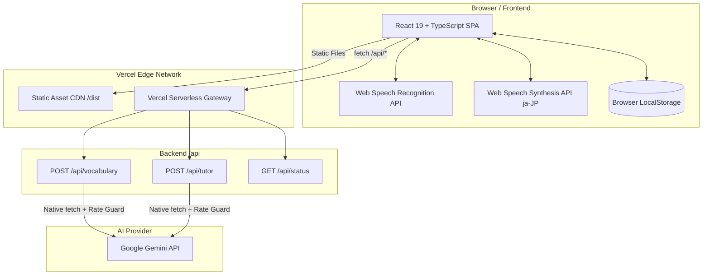
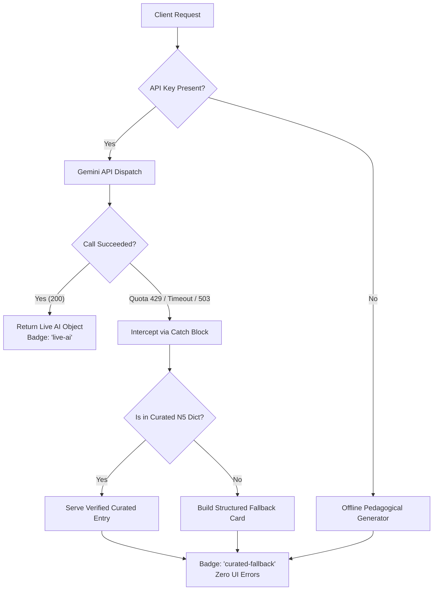

# Nipp-On — Complete Technical Architecture & Developer Reference

> **Document Purpose**: This document serves as the comprehensive technical documentation for **Nipp-On** (`Nihon-Go`). It details system architecture, serverless design, API specifications, audio subsystems, data persistence, and engineering decisions.
>
> **Canonical Repository**: [https://github.com/akhilkumar0024/Nipp-On](https://github.com/akhilkumar0024/Nipp-On)  
> **Live Production URL**: [https://nipp-on.vercel.app/](https://nipp-on.vercel.app/)

---

## 1. System Architecture

Nipp-On is structured as a **Full-Stack Jamstack Application** deployed on Vercel:



---

## 2. Technology Stack Specifications

| Layer | Technologies & Libraries | Key Details |
| :--- | :--- | :--- |
| **Frontend Core** | React 19 (`^19.2.8`), TypeScript (`~6.0.2`), Vite (`^8.3.0`) | Strict mode enabled, solutions-style compiler configurations |
| **Design System** | Tailwind CSS (`^3.4.19`), PostCSS, Google Stitch Tokens | Custom color tokens: Pine Forest Green, Terracotta Earth |
| **Typography** | Google Fonts | `Noto Serif JP` (Kanji hero), `Plus Jakarta Sans` (UI / Latin), `Material Symbols Outlined` |
| **Audio Engine** | Web Speech API | Client-side native `window.speechSynthesis` and `SpeechRecognition` |
| **Backend Runtime** | Node.js (v20+ on Vercel Serverless) | Pure native `fetch`, self-contained modules, zero cross-file imports |
| **AI Engine** | Google Gemini API | Primary: `gemini-3.5-flash-lite`, Failover: `gemini-3.5-flash`, `gemini-flash-latest` |
| **Client Storage** | LocalStorage Engine | Strict schema versioning, JSON corruption recovery, demo starter data injection |

---

## 3. Serverless Backend & API Specifications

To guarantee zero cold-start failures in Node.js ESM environments (`"type": "module"`), each serverless endpoint in `/api` is **100% self-contained** without cross-file internal imports.

### 3.1. GET `/api/status`
Checks the server health, process uptime, and whether `GEMINI_API_KEY` is active.

* **Method:** `GET` (Rejects non-GET with `405`)
* **Headers:** `Access-Control-Allow-Origin: *`
* **Response Body (`200 OK`):**
  ```json
  {
    "success": true,
    "geminiConfigured": true,
    "model": "gemini-3.5-flash-lite",
    "uptime": 14.28,
    "timestamp": "2026-10-12T08:40:29.636Z"
  }
  ```

---

### 3.2. POST `/api/vocabulary`
Generates a comprehensive beginner-friendly JLPT N5 vocabulary breakdown.

* **Method:** `POST` (Rejects non-POST with `405`)
* **Request Limits:** Max body size 2KB, max query length 100 characters.
* **Request Body:**
  ```json
  {
    "query": "sakura"
  }
  ```
* **Response Body (`200 OK`):**
  ```json
  {
    "success": true,
    "data": {
      "id": "sakura",
      "japanese": "桜",
      "hiragana": "さくら",
      "romaji": "sakura",
      "english": "Cherry blossom; cherry tree",
      "partOfSpeech": "Noun",
      "jlptLevel": "N4",
      "frequency": "Frequency Top 500",
      "pitchAccent": {
        "pattern": "Heiban pattern (平板型) ￣",
        "notation": "[sa-ku-ra]",
        "moras": [
          { "mora": "sa", "pitch": "low" },
          { "mora": "ku", "pitch": "high" },
          { "mora": "ra", "pitch": "high" }
        ]
      },
      "nuance": "Sakura holds deep cultural significance in Japan...",
      "exampleSentence": {
        "japanese": "公園にきれいな桜が咲いています。",
        "furigana": "こうえん に きれいな さくら が さい て い ます 。",
        "romaji": "Kōen ni kireina sakura ga saite imasu.",
        "english": "There are beautiful cherry blossoms blooming in the park."
      },
      "source": "live-ai"
    }
  }
  ```

---

### 3.3. POST `/api/tutor`
Maintains conversational tutoring dialogues with contextual memory of the active vocabulary item.

* **Method:** `POST` (Rejects non-POST with `405`)
* **Request Limits:** Max body size 8KB, max message length 300 characters, history capped to last 8 messages.
* **Request Body:**
  ```json
  {
    "word": {
      "japanese": "桜",
      "hiragana": "さくら",
      "romaji": "sakura",
      "english": "Cherry blossom"
    },
    "message": "How do I say cherry blossom viewing party?",
    "history": []
  }
  ```
* **Response Body (`200 OK`):**
  ```json
  {
    "success": true,
    "data": {
      "text": "Konnichiwa! To say cherry blossom viewing party, Japanese speakers use 花見 (hanami)...",
      "suggestions": [
        "How do I say 'Let's go to hanami'?",
        "What month is sakura season?",
        "Can you teach me another example?"
      ],
      "source": "live-ai"
    }
  }
  ```

---

## 4. Resilience & Fallback Circuit Breaker

To prevent crashes when third-party quotas are reached or when running without API keys, a multi-tier fallback system is implemented:



* **Sensei Chat Protection:** When Gemini quota is exhausted, `generateCuratedTutorResponse()` parses intent (restaurant etiquette, polite conjugations, casual slang, noun copulas) and provides a pedagogical response with follow-up suggestions tagged `source: 'curated-fallback'`.
* **Client-Side Protection:** `src/services/api.ts` parses response bodies as plain text prior to `JSON.parse`. If a platform 500 error occurs, it falls back to local client memory (`findCuratedWord()`) rather than throwing raw syntax errors.

---

## 5. Audio Subsystem & Pronunciation Engineering

### 5.1. Kun'yomi vs. On'yomi Phonetic Integrity
* **The Problem:** Kanji characters like `水` have multiple readings (Kun'yomi `mizu` vs. On'yomi `sui`). Passing raw Kanji characters to `window.speechSynthesis` causes browsers to default to On'yomi (`sui`).
* **The Solution:** The audio service strictly passes the **phonetic Hiragana reading** (`word.hiragana || word.japanese`) to `SpeechSynthesisUtterance`. This guarantees natural Kun'yomi pronunciation (`mizu`).

### 5.2. Markdown Sanitization for Speech
* **The Problem:** AI-generated text contains markdown formatting (`**水**`, `*mizu*`). Unsanitized speech synthesis engines pronounce formatting symbols aloud (*"asterisk asterisk"*).
* **The Solution:** `audioService.speakJapanese()` sanitizes all formatting characters (`*`, `_`, `#`, `` ` ``, `~`) via regular expressions before dispatching the speech utterance.

### 5.3. Speech-to-Text (STT) Graceful Degradation
* **Engine:** `webkitSpeechRecognition` / `SpeechRecognition` configured for `ja-JP` and `en-US`.
* **Fallback:** On unsupported browsers (or when microphone permission is denied), voice buttons gracefully toggle off with a helpful toast prompting the user to use text search.

---

## 6. Directory Structure & File Map

```
Nihon-Go/
├── api/                           # Standalone serverless backend endpoints
│   ├── status.ts                  # GET /api/status - Health & key status
│   ├── tutor.ts                   # POST /api/tutor - Sensei dialogue & fallback
│   └── vocabulary.ts              # POST /api/vocabulary - Lexical breakdown & fallback
├── design_reference/              # Reference Google Stitch Material 3 mockups
│   ├── nihon_go_01_dashboard.html
│   ├── nihon_go_02_vocabulary.html
│   ├── nihon_go_03_ai_sensei.html
│   └── nihon_go_04_notebook_quiz.html
├── src/
│   ├── components/
│   │   ├── layout/
│   │   │   ├── SideNavBar.tsx         # Collapsible desktop/mobile navigation drawer
│   │   │   └── TopNavBar.tsx          # Sticky header with streaks, goals, audio & profile
│   │   ├── modals/
│   │   │   ├── AudioSettingsModal.tsx # TTS voice, pitch, and playback rate selectors
│   │   │   ├── FeedbackModal.tsx      # User feedback modal
│   │   │   └── ProfileModal.tsx       # User profile & learner stats modal
│   │   └── screens/
│   │       ├── DashboardScreen.tsx        # Overview, daily milestone, flashcards & streak
│   │       ├── VocabularyScreen.tsx       # Search bar, kanji card, mora pitch & voice input
│   │       ├── TutorScreen.tsx            # Split-pane AI Sensei tutor dialogue
│   │       └── PracticeNotebookScreen.tsx # Interactive quiz session & persistent notebook
│   ├── data/
│   │   └── curatedVocab.ts        # Verified JLPT N5 vocabulary dataset & offline fallback
│   ├── services/
│   │   ├── api.ts                 # Client fetch wrapper with defensive text-to-JSON parsing
│   │   ├── audio.ts               # Web Speech Synthesis & Recognition service
│   │   └── storage.ts             # LocalStorage manager with schema corruption recovery
│   ├── types/
│   │   └── index.ts               # Shared TypeScript domain models & interfaces
│   ├── App.tsx                    # Top-level state coordinator & screen router
│   ├── index.css                  # Stitch global styles, typography, scrollbar styling
│   └── main.tsx                   # React 19 DOM entry point
├── package.json                   # Dependencies, scripts, and ESM definition
├── tailwind.config.js             # Stitch Material 3 design tokens & color definitions
├── tsconfig.json                  # Root TypeScript configuration with Node types
├── vercel.json                    # Vercel deployment routing & framework definitions
└── vite.config.ts                 # Vite bundler configuration & local API middleware
```

---

## 7. Working Rules for Future Development

1. **Aesthetics & Design Tokens:**
   - Strictly adhere to Google Stitch specifications. Never use generic Tailwind colors (e.g. `blue-500`, `green-600`). Always use semantic tokens (`primary`, `secondary`, `surface-container`, etc.).
2. **Serverless Isolation:**
   - Keep files inside `/api` self-contained. Do not introduce cross-file imports between serverless endpoints to avoid Node ESM resolution issues in cloud environments.
3. **Phonetic Dispatch:**
   - Standalone Japanese audio calls must always pass clean Hiragana readings to guarantee Kun'yomi pronunciation.
4. **Data Integrity:**
   - All learner statistics (streaks, quiz attempts, saved words) must persist through `storage.ts` using authentic user interactions.
